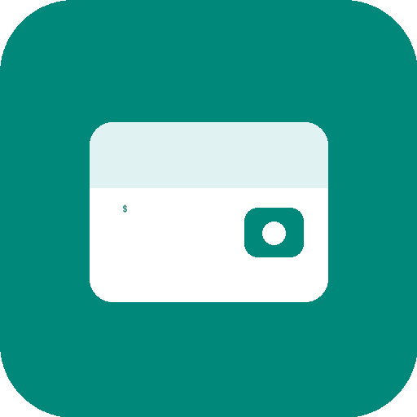
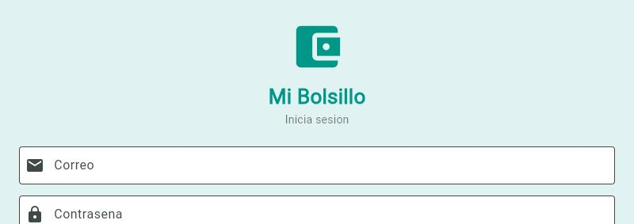
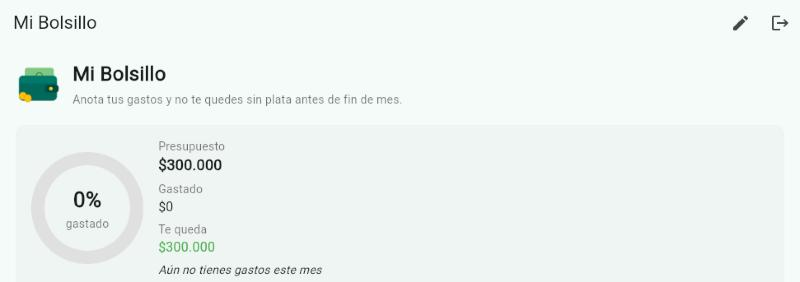
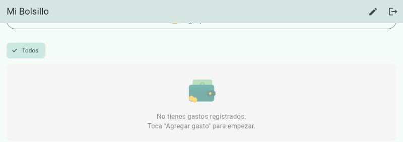

# Ficha de tienda — Mi Bolsillo

*Propuesta de ficha para una tienda de aplicaciones (ejercicio del Taller Final, ET0126).*

## 1. Nombre y categoría
- **Nombre de la aplicación:** Mi Bolsillo
- **Categoría propuesta:** Finanzas / Finanzas personales

## 2. Descripción corta
Controla tus gastos y no te quedes sin plata antes de fin de mes.

## 3. Descripción completa
**Mi Bolsillo** es una aplicación sencilla para que los estudiantes (y cualquier persona) lleven el control de sus gastos del mes y de su presupuesto.

- **¿Para quién es?** Para estudiantes que reciben una mesada o un presupuesto y quieren saber en qué se les va la plata.
- **¿Qué problema resuelve?** Muchas veces uno gasta sin darse cuenta y a mitad de mes ya no tiene plata. La app ayuda a ver cuánto se ha gastado, cuánto queda y si el dinero alcanza para todo el mes.
- **Funciones principales:**
  - Registrar gastos con su valor y categoría.
  - Fijar un presupuesto del mes y ver cuánto queda.
  - Un anillo visual (dibujado con Canvas) que muestra el porcentaje gastado.
  - Resumen y filtro de gastos por categoría.
  - Lista de pagos pendientes con validación de datos.
  - **Inicio de sesión seguro con Firebase** (cada usuario entra con su cuenta).

## 4. Público objetivo
Estudiantes de secundaria y universidad, y en general personas jóvenes que manejan un presupuesto limitado. Les resulta útil porque es simple, en español, y les avisa de forma visual cuando se están pasando del presupuesto.

## 5. Ícono y capturas
**Ícono propuesto:**

**Capturas reales de la aplicación:**

| Captura | Qué muestra |
|---|---|
|  | **Inicio de sesión:** el usuario entra con su correo y contraseña (autenticación con Firebase). |
|  | **Pantalla principal:** presupuesto del mes, cuánto se ha gastado, cuánto queda y el anillo de avance. |
|  | **Lista de gastos y filtro:** desde aquí se agregan y revisan los gastos por categoría. |

## 6. Datos y permisos
- **Qué información maneja:** el correo del usuario (para la cuenta) y los gastos/presupuesto que la persona registra.
- **Para qué usa la autenticación:** para que cada persona tenga su propia cuenta y solo ella vea su información; permite iniciar y cerrar sesión.
- **Permisos que solicita:** acceso a internet (para la autenticación con Firebase). No pide cámara, contactos, ubicación ni micrófono.

## 7. Política de privacidad propuesta
- **Qué datos se recogen:** el correo electrónico (para la cuenta) y los datos de gastos que el usuario escribe.
- **Para qué se usan:** únicamente para que la app funcione (identificar al usuario y mostrarle su información). No se venden ni se comparten con terceros.
- **Almacenamiento:** el inicio de sesión se maneja con Firebase Authentication; los gastos se guardan en el dispositivo (almacenamiento local).
- **Ayuda o eliminación:** el usuario puede escribir al correo de soporte para pedir ayuda o solicitar que se elimine su cuenta.
- **Pendiente por definir:** aún falta redactar una política de privacidad formal y definir el correo de soporte oficial.

## 8. Estado de lanzamiento
- **Versión propuesta:** 1.0.0
- **Funciones listas:** registro e inicio de sesión con Firebase, control de gastos, presupuesto, anillo de avance (Canvas), pagos pendientes con validación.
- **Limitaciones conocidas:** los gastos se guardan solo en el dispositivo (no se sincronizan en la nube todavía); aún no hay recuperación de contraseña.
- **Mejoras futuras:** guardar los gastos en la nube (Firestore) para verlos en varios dispositivos, agregar gráficas de gastos por mes, recordatorios de pagos pendientes y recuperación de contraseña.

---
*Esta ficha describe lo que la aplicación realmente hace. ET0126 · Programación de Dispositivos Móviles · I.U. Pascual Bravo.*
